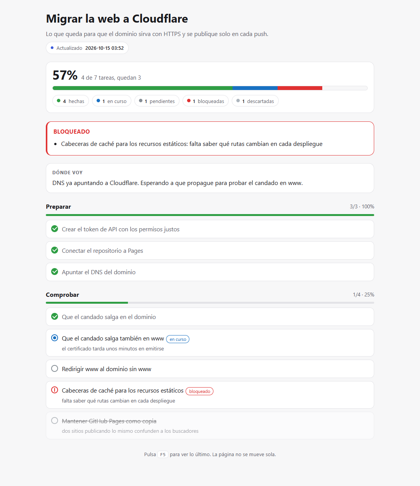

# Gresso

A Claude Code skill that gives a long task its own live progress page. Instead of narrating
every step in the terminal, or making you interrupt it to ask how far along it is, the agent
keeps rewriting one HTML file as it works: a progress bar, a percentage, what is done, what is
left and what is blocked. You leave the tab open and press `F5` whenever you want to look.



## Install

Inside Claude Code, two lines:

```
/plugin marketplace add Mun1to/Vibeset
/plugin install gresso@vibeset
```

If the install summary says `Run /reload-plugins to activate`, run it.

<details>
<summary>Prefer to install it by hand?</summary>

Clone the repository and point your skills folder at it.

```bash
git clone https://github.com/Mun1to/Gresso.git
ln -s "$(pwd)/Gresso" ~/.claude/skills/gresso
```

On Windows, with PowerShell:

```powershell
New-Item -ItemType Junction -Path "$env:USERPROFILE\.claude\skills\gresso" -Target "C:\path\to\Gresso"
```
</details>

It needs Python 3 on the machine, and nothing else: no packages, no server, no account.

## Use it

You do not have to ask. When a task has four steps or more, or is going to take a while, the
agent sets up the page on its own, opens it in your browser once and tells you in one line.
You can also ask for it: "show me your progress", "what is left", "track this", or `/gresso`.

For a one-off answer or a two-line fix it stays out of the way: a progress page for three
steps is ceremony.

## What it looks like

One HTML file, opened straight in your own browser, never a hosted page:

- A big percentage and the number of tasks left, which is the question you actually have.
- A progress bar in three colors: done in green, in progress in blue, blocked in red, so you
  can tell at a glance whether what is left is moving or stuck.
- Blocked tasks jump to the top in their own box, each with what is missing to unblock it.
- A short "where I am" note the agent keeps up to date, in two or three lines.
- Tasks grouped in phases, each with its own small bar and count.
- Dropped tasks stay visible but crossed out, and do not count towards the total, so the
  percentage never lies by keeping work that is no longer going to happen.
- The time of the last update in the header, and the percentage in the tab title, so you can
  check it without even switching tabs.
- Light or dark following your system, readable on a phone, no internet needed.
- It does not refresh by itself, on purpose: nothing moves while you are reading. Reloading
  keeps your scroll position.

The page labels are in Spanish. The task text is whatever language the agent writes it in.

## How it works

The page carries its data in a JSON block, and a small script (`scripts/gresso.py`) rewrites
only that block: `crear` (create), `estado` (change states), `parte` (the "where I am" note),
`anadir` (add tasks) and `ver` (print the current state as text). The agent never loads the
HTML into its context to update it, so keeping the page current costs almost nothing.

Task ids never change once given, even when new tasks are added in the middle, so the agent
can remember them and mark the right one later.

## Why

The two usual ways of knowing where an agent is are both bad: you interrupt it to ask, or you
wait for the summary at the end. A progress report that only appears when the work is over is
not tracking, it is a report. This skill is the concrete way of keeping the tracking honest
while the work is still happening.

## Don't trust it, check it

Open source only helps if somebody actually reads the code, and almost nobody does. So instead
of asking you to trust this project, here is the prompt to check it: point your own AI agent at
this repository and get a security report, in your language, in a few minutes, even if you do
not know how to program.

**[Open AI-AUDIT.md](AI-AUDIT.md)** and paste it into Claude Code, Codex, Cursor, Copilot or
whatever you use. It is the same prompt in every public repository here, so you can compare.

## License

MIT, see [LICENSE](LICENSE).
